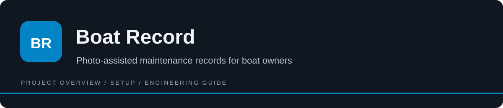

<p align="center"></p>

# Boat Record

Boat Record keeps an owner’s boat systems, service entries, and engine-hour readings together. A photo can prefill a structured record, but the owner reviews the extraction before it becomes saved history. Calendar and hour-based reminders help organize maintenance, while a revocable read-only link makes selected history accessible to a prospective buyer or broker. This is an application with authentication, database policies, private photo storage, and provider integrations—not a standalone image-extraction library.

[](https://github.com/ak1458/carfax-for-boats/stargazers)
[](https://github.com/ak1458/carfax-for-boats/watchers)
[](https://github.com/ak1458/carfax-for-boats/forks)
[](https://github.com/ak1458/carfax-for-boats/activity)
[](LICENSE)
[](https://github.com/ak1458/carfax-for-boats/releases)

**[How it works](#how-it-works) · [Run locally](#run-locally) · [Configuration](#configuration) · [Commands](#development-commands) · [Versions](#versions-and-distribution) · [License](#license)**

## How it works

1. Sign in through Supabase and create a boat and its systems inventory.
2. Capture an engine plate, receipt, or hour-meter photo; the extraction route returns proposed fields and confidence information.
3. Review or correct those fields before saving. Manual entry remains the fallback when extraction is unavailable.
4. Log service and engine hours, inspect due reminders, and create or revoke a share token when needed.

## Architecture

| Path | Purpose |
| --- | --- |
| [src/lib/extraction/](<src/lib/extraction/>) | Provider adapter and structured extraction schemas. |
| [src/lib/reminders/](<src/lib/reminders/>) | Due-date and engine-hour rules. |
| [src/lib/share/](<src/lib/share/>) | Share-token helpers. |
| [src/app/r/[token]/](<src/app/r/[token]/>) | Read-only shared-record route. |
| [supabase/migrations/](<supabase/migrations/>) | Tables, owner policies, and photo storage setup. |
| [tests/unit/](<tests/unit/>) | Extraction fixtures, schemas, due rules, and token tests. |

## What it does

- Captures engine plates, receipts, and hour-meter photos.
- Extracts proposed structured data for the owner to review before saving.
- Tracks service history and maintenance due by time or engine hours.
- Creates revocable, read-only share links for buyers and brokers.

## Run locally

```bash
git clone https://github.com/ak1458/carfax-for-boats.git
cd carfax-for-boats
npm ci
cp .env.example .env.local
npm run dev
```

Configure Supabase URL/keys, an Anthropic API key for image extraction, and optional email/cron settings from [.env.example](.env.example). Apply the [database migration](supabase/migrations/0001_init.sql) to a development Supabase project and configure authentication redirects and photo storage.

## Engineering notes

| Concern | Location |
| --- | --- |
| Extraction schema and provider | `src/lib/extraction/` |
| Due-date rules | `src/lib/reminders/` |
| Share-token generation | `src/lib/share/` |
| Ownership policies | `supabase/migrations/` |
| Unit and browser checks | `tests/`, `e2e/` |

Available checks: `npm test`, `npm run lint`, `npm run build`, and `npm run e2e`. Browser and integration flows require configured services.

Extraction is advisory. A photo-backed record is not an independent inspection or a guarantee of the underlying maintenance work.


## Configuration

Settings template: [.env.example](<.env.example>). Copy it to the application’s local environment file and fill only the integrations you use.

| Variable | Purpose |
| --- | --- |
| `NEXT_PUBLIC_SUPABASE_URL` | Supabase project endpoint; use the intended development project. |
| `NEXT_PUBLIC_SUPABASE_ANON_KEY` | Publishable client key; access still depends on authentication and database policies. |
| `SUPABASE_SERVICE_ROLE_KEY` | Privileged server-only Supabase key; never expose in the client. |
| `ANTHROPIC_API_KEY` | Provider credential. Keep server-side; public-prefixed legacy options must not contain production secrets. |
| `EXTRACTION_MODEL` | Model identifier used by the selected provider integration. |
| `RESEND_API_KEY` | Provider credential. Keep server-side; public-prefixed legacy options must not contain production secrets. |
| `CRON_SECRET` | Server secret protecting scheduled-operation routes. |
| `NEXT_PUBLIC_APP_URL` | Application origin/redirect setting; match the target environment. |

Environment files and provider tokens must remain untracked. A public client prefix exposes a value in the browser bundle; it is not a safe place for privileged credentials.

## Development commands

Workspace: [package.json](<package.json>). Run these commands from its directory.

| Command | Script defined in manifest |
| --- | --- |
| `npm run dev` | `next dev` |
| `npm run build` | `next build` |
| `npm run start` | `next start` |
| `npm run lint` | `eslint` |
| `npm run test` | `vitest run` |
| `npm run test:watch` | `vitest` |
| `npm run e2e` | `playwright test` |

These are available commands, not a claim that all checks passed in this documentation pass. Connected checks require the services, credentials, and isolated data described above.

## Operational notes

Provisioning is separate from installing npm dependencies. Apply the Supabase migration, configure callback URLs, and provide the server-only service-role key before testing protected or shared pages. The optional Resend integration is for reminder email; it is not required to understand the in-app data model. Retain source photos when reviewing entries: extracted text is advisory evidence, not proof that maintenance occurred.

## Troubleshooting

| Symptom | What to check |
| --- | --- |
| Magic-link login returns to the wrong page | Set the application URL and allow the matching /auth/callback redirect in Supabase. |
| Uploads or save operations fail | Check the migration, storage bucket, signed-in user, and owner policies in a development project. |
| Browser tests fail before a user flow | Configure the dev server and Supabase, or supply the supported E2E_BASE_URL; fixture-only unit tests do not provision services. |

## Versions and distribution

Manifest versions are application/workspace metadata, not a certification of release readiness.

| Manifest | Declared version |
| --- | --- |
| [package.json](<package.json>) | `0.1.0` |

Published release entries:

- [v0.1.0](https://github.com/ak1458/carfax-for-boats/releases/tag/v0.1.0) — published release.

GitHub Packages is a separate registry. This README does not imply that a registry package exists; use the installation path documented here rather than an invented package-install command.

## Documentation and maintenance

- [CHANGELOG.md](<CHANGELOG.md>)
- [SECURITY.md](<SECURITY.md>)
- [CONTRIBUTING.md](<CONTRIBUTING.md>)
- [docs/superpowers/specs/2026-06-11-carfax-for-boats-design.md](<docs/superpowers/specs/2026-06-11-carfax-for-boats-design.md>)

For change proposals, see [CONTRIBUTING.md](CONTRIBUTING.md). Include the affected workflow, reproduction steps, and relevant check output when reporting a problem. Do not include credentials or live customer data.

## License

This repository’s project code is **proprietary / all rights reserved**. Public visibility does not grant unrestricted reuse. Read [LICENSE](<LICENSE>) for the exact terms. Third-party dependencies and bundled components retain their own notices.
